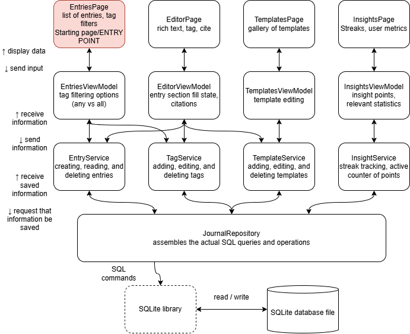

# Memoseum

A Windows journaling program that makes it easy to record your thoughts, keeps them organized with tags and templates, and incentivizes consistency.

## The Problem

I regularly conceive ideas, reflect on events, and draw conclusions, yet I constantly fail to record these thoughts such that I could later refer back to them. Typically, I lack motivation/incentive to actually record my thoughts and even when I do, they are often recorded in a disorganized manner that requires great effort to actually retrieve. The goal of this program is to alleviate these aforementioned problems by making journaling organized and rewarding.

## How It Works

- **Journal entries:** write and save entries, then browse them on a main page.
- **Custom tags:** label entries with your own tags and filter the entry list by tag, matching either any or all of the selected tags.
- **Entry templates:** start an entry from a template made of named sections, such as "What went well" or "What are you hungry for right now".
- **Citation of previous entries:** reference earlier entries from a new one, so ideas build on each other.
- **Incentivization:** journaling streaks, metrics, and insight points awarded for word count or for filling out the sections of a template.

The app follows the MVVM pattern. Pages/views bind to ViewModels, which call a set of services (entries, tags, templates, insights). The services use a single repository, which is the only code that talks to the SQLite database.

## Tech Stack

- **Language:** C#
- **UI framework:** WinUI 3
- **Architecture:** MVVM (MVVM toolkit library)
- **Database:** SQLite
- **External tools:** Visual Studio 2026 Insiders Edition, Git, GitHub

## Roadmap

Planned for V2.0 and later:

- [ ] Node graph display of entries and their connections
- [ ] Advanced search functionality
- [ ] Attach media and music to journal entries
- [ ] Journal sharing
- [ ] Database encryption with a personal, user-made key
- [ ] Analysis of the metrics (for example, which tag is least frequent this month)
- [ ] Intelligent time capsule: resurface previous entries with tags similar to the one being written

## Author

[rexryan2007](https://github.com/rexryan2007)